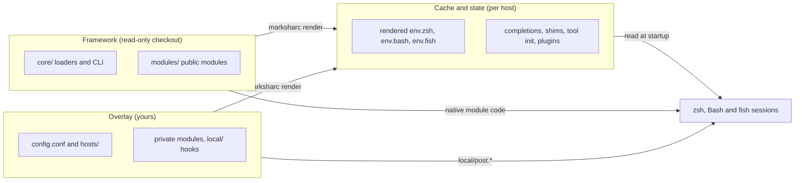
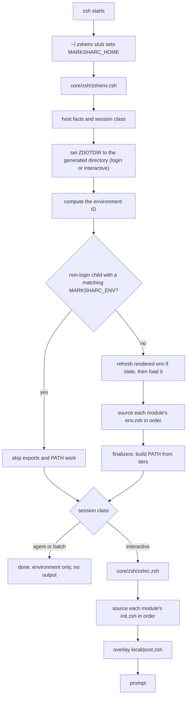
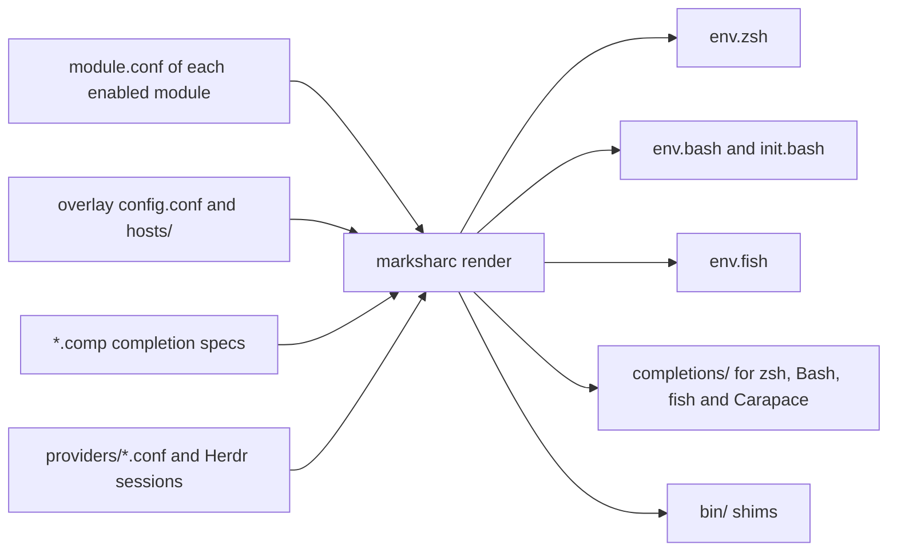

# Architecture

This page explains how marksharc is put together and what happens when a shell starts. Read it
before changing anything under `core/`. The [specification](../specs/MARKSHARC-SPEC.md) is the
contract; this page is the tour.

- [Three layers](#three-layers)
- [Repository layout](#repository-layout)
- [Startup](#startup)
- [Session classification](#session-classification)
- [The module loader](#the-module-loader)
- [Rendering](#rendering)
- [PATH](#path)
- [Caches](#caches)
- [Reload](#reload)
- [The command](#the-command)
- [Write-once commands and shims](#write-once-commands-and-shims)
- [Where state lives](#where-state-lives)

## Three layers



The framework is never written at run time, so an update is always a fast-forward. Everything a
user changes is in the overlay. Everything marksharc derives is in the cache and state
directories and can be deleted.

## Repository layout

```text
install.sh               Day 0 installer, POSIX sh
bin/marksharc            command entry point
core/
  zsh/
    zshenv.zsh           env phase (every shell)
    zprofile.zsh         login: re-assert PATH after /etc/zprofile
    zshrc.zsh            init phase (interactive only)
    zlogin.zsh           login-only steps
    phase.zsh            sources one phase's module files
    finalize.zsh         runs env finalizers, including the PATH build
    reload.zsh           reload in the current shell
    lib/                 session, facts, envid, modules, cache, directives, zdot, util,
                         render, render-bash, render-fish, render-completions, rendered,
                         shims, carapace, json, pick
  bash/                  env.bash and bashrc.bash entry points, plus interactive.bash and
                         its libraries (hooks, ownership, backends, complete, path, cache, …)
  fish/                  marksharc.fish and lib/ (modules, path, cache, directives, plugins)
  cli/                   one executable per subcommand; *-lib.zsh are shared
  completions/           marksharc.comp
modules/<name>/          one directory per module
templates/overlay/       skeleton for a new overlay
tests/                   suites, lint, e2e scripts, support tools
docs/  specs/  memory/
```

## Startup

Each shell runs up to two phases.

- **env** runs in every shell. It computes host facts, classifies the session, loads the
  rendered environment and builds PATH. It prints nothing and starts no process on a warm start.
- **init** runs only in an interactive session. It sets options, key bindings, completion, the
  prompt, plugins and cached tool integrations, then sources the overlay's `local/post.<shell>`.



Bash and fish follow the same two phases with their own entry points:

| Shell | Entry | env phase | init phase |
| --- | --- | --- | --- |
| zsh | `~/.zshenv` stub, then the generated `ZDOTDIR` files | `core/zsh/zshenv.zsh` | `core/zsh/zshrc.zsh` |
| Bash | `~/.bashrc` and `~/.bash_profile` stubs; `BASH_ENV` when enabled | `core/bash/env.bash` loads the rendered `env.bash` | `core/bash/interactive.bash`, on Bash 4.4+ at a terminal |
| fish | `conf.d/00-marksharc.fish` | `core/fish/marksharc.fish` loads the rendered `env.fish` | The same file, when the session is interactive |

zsh is the only shell that computes the environment itself. Bash and fish read what the zsh
renderer wrote. When fish finds its rendered file older than an input, it runs
`marksharc render --env-only` through zsh before loading it.

### Why `ZDOTDIR` moves

The env phase points `ZDOTDIR` at `~/.local/state/marksharc/zdot`, which holds four one-line
files that source `core/zsh/zprofile.zsh`, `zshrc.zsh` and so on. zsh then ignores the dotfiles
in the home directory, so an installer that appends to `~/.zshrc` cannot change the shell. The
directory is regenerated when a file or its version marker is missing. Coexist mode skips this
step and is sourced from the user's own `~/.zshenv` and `~/.zshrc`.

### Surviving a broken module

`core/zsh/phase.zsh` sources each module file inside an `always` block, so a recoverable error
only skips the rest of that file. A non-interactive shell would still exit on a fatal expansion
such as `${x:?}`. So, outside interactive sessions, `_ms_module_guard` first sources the file in
a subshell and skips it if that fails. The verdict is cached per file and environment ID under
`guard/` in the cache.

If the core itself cannot be loaded, the `~/.zshenv` stub sets a minimal PATH and prints one
line.

## Session classification

`core/zsh/lib/session.zsh` sets `MARKSHARC_SESSION` once per shell:

1. If any agent marker variable is set, non-empty and not `0`, the class is `agent`.
2. Otherwise, if the shell is interactive and both stdin and stdout are terminals, it is
   `interactive`.
3. Otherwise it is `batch`.

The value is local to the shell and never exported, because a child shell can be a different
class from its parent. A reload keeps the class it had, since its output may be redirected.

The marker list comes from `set agent.markers` in the overlay when present, and from the
built-in default otherwise. It is read directly from `config.conf` here, before any module has
loaded.

## The module loader

`core/zsh/lib/modules.zsh` does three things.

**Discover.** `_ms_modules_discover` reads `config.conf` and the host file, then every
`module.conf` under the framework's `modules/` and the overlay's `modules/`. An overlay module
replaces a framework module of the same name. It records each module's description, order,
requirements and options, and sorts the enabled ones by order and then name.

**Plan.** `_ms_modules_plan env|init` selects the modules for a phase. It drops modules whose
operating system does not match. In the init phase it also drops modules whose required command
is missing. In the env phase that check is made at each module's own turn, because PATH is still
being assembled and an earlier module (Homebrew, for instance) may contribute the directory that
holds the command. It sets each declared option as `$_ms_opt_<module>_<key>`.

**Run.** `phase.zsh` sources `<phase>.zsh` for each planned module. In the env phase it then
calls the rendered function for that module's declarative lines.

Before the init loop, `_ms_modules_setup_paths` puts each module's `functions/zsh` and
`completions/zsh` on `fpath` and autoloads the functions.

## Rendering

Rendering turns declarative lines into plain shell. It is what keeps startup cheap: the
tokenising, the option lookups and the `when os` and `when host` decisions happen once, not in
every shell.



- `core/zsh/lib/render.zsh` writes `env.zsh`. `render-bash.zsh` and `render-fish.zsh` write the
  Bash and fish equivalents from the same parsed lines. `render-completions.zsh` handles `.comp`
  specs, and `shims.zsh` writes the generated commands.
- Values are quoted into the target shell's syntax. Directive text is never evaluated.
- `when command`, `when dir` and `when file` become runtime tests in the rendered file.
  `when os` and `when host` are decided during the render.
- Each output is written to a temporary name and moved into place. `render-id`, `completion-id`
  and `shim-id` record the environment ID each set was built for.

There are two render depths. A shell that finds its environment stale refreshes only the
environment files; it never runs a completion generator, so a batch or agent shell cannot
trigger one. The full render, with completions and shims, runs from `install.sh`,
`marksharc render`, `marksharc update` and `marksharc reload`.

Activation is transactional. `core/zsh/lib/rendered.zsh` snapshots the active state before a
render and restores it if the render fails, so a bad line in the overlay leaves the previous
environment working.

### The environment ID

`core/zsh/lib/envid.zsh` folds the modification time and size of every file under `core/`,
`modules/` and the overlay into one value, using shell arithmetic and no external process. The
env phase exports it as `MARKSHARC_ENV`. A non-login child shell that inherits the same value
knows its exports and PATH are already correct and skips the work. Any edit to an input changes
the ID, so the next shell rebuilds.

## PATH

`modules/path/env.zsh` owns PATH. Modules and rendered `path` lines call
`_ms_path_add <tier> <dir>` during the env phase. Nothing is built until every module has run:
the path module registers a finalizer, and `core/zsh/finalize.zsh` runs the finalizers after
the last module. It first adds the shim directory and each planned module's `bin/` to the
`user` tier.

`_ms_path_build` joins the tiers in order, keeps inherited entries it does not manage (those
ahead of the first managed entry stay near the front), removes duplicates, and records which
entries it generated. On a reload, an entry it generated earlier and no longer contributes is
dropped; everything else is untouched.

On macOS, `/etc/zprofile` runs `path_helper`, which reorders PATH after the env phase. For login
shells `core/zsh/zprofile.zsh` puts the env-phase order back and appends anything new.

## Caches

`_ms_init_cached <tool> <command…>` in `core/zsh/lib/cache.zsh` stores the output of a tool's
shell integration, such as `starship init zsh`, in `init/` under the cache. The key is the
binary's resolved path, its modification time and the arguments. A hit sources the file and
starts no process. Upgrading the tool changes the key, so the cache refreshes itself. Bash and
fish have the same helper (`_ms_bash_init_cached`, `_ms_fish_init_cached`).

This is the one place generated text is sourced: it is the tool's own documented integration.

## Reload

`marksharc reload` cannot be a program, because a child process cannot change its parent. In an
interactive zsh, `marksharc` is a function defined by `zshrc.zsh`. For `reload` it sources
`core/zsh/reload.zsh`; for anything else it runs `bin/marksharc`.

`reload.zsh` forces a rebuild, sources `zshenv.zsh` again and then `zshrc.zsh`. Two details make
this safe:

- **Module files declare with `-g`.** At startup they run at top level; on reload they run
  inside the `marksharc` function, where a bare `typeset` would be local and vanish.
  `tests/support/function-safe-check.py` enforces the rule.
- **Each init can register a cleanup.** A module that installs hooks adds a function to
  `_ms_init_cleanups`; the next init runs these first, so hooks are replaced and not stacked.

Bash and fish define their own `marksharc` function and `cs` and `li`, with the same contract.

## The command

`bin/marksharc` resolves the framework from its own path, then runs
`zsh -f core/cli/<command>`. `-f` means no startup files, so the command behaves the same
whatever the calling shell's configuration is. Adding a subcommand means adding an executable
to `core/cli/` and a line to the usage text and `core/completions/marksharc.comp`.

`core/cli/day2-lib.zsh` is shared by `bootstrap`, `update` and `install`. It walks the planned
modules' `module.conf` files and the overlay's config files and hands each tokenised line to a
callback, which is how those commands collect `package`, `update` and `installer` lines.

`notify` and `complete` are internal: the detached behind-check, and the offline candidate
helper for declarative completions.

## Write-once commands and shims

A command with real logic is one zsh executable in a module's `bin/`. It works from zsh, Bash,
fish and agent shells because it is a program on PATH, not a shell function.

A program cannot `cd` its caller. When a command needs to change the calling shell, a thin
native wrapper function sets `MARKSHARC_DIRECTIVES` to a temporary file, runs the program, then
applies the lines the program wrote: `cd`, `pushd`, `setenv`, `unsetenv` or `exit`. The applier
(`directives.zsh`, `directives.bash` and `directives.fish` under `core/`) treats every field as data. [write-once.md](write-once.md) and
[MODULE-AUTHORING.md](MODULE-AUTHORING.md#commands) show how to use it.

Commands generated from data, such as one per provider file, are written by the renderer as
small executables in the per-host `bin/` directory. They read their data file when they run, so
no secret is copied into the cache.

## Where state lives

```text
~/.cache/marksharc/
  plugins/<name>@<sha>/        pinned plugin clones, shared by every host
  <host>/
    env.zsh  env.bash  env.fish  init.bash     rendered environment
    render-id                                  the environment ID they were rendered for
    completions/  completion-id  completion-files
    bin/  shim-id  shim-files                  generated commands
    init/                                      cached tool integration output
    guard/                                     module validation verdicts
    zcompdump  zcompdump.fpath                 zsh completion dump
    sync/                                      behind-check status and lock
    repos/                                     repository inventory for launch-repo

~/.local/state/marksharc/
  install.manifest             what the installer changed
  backup/<timestamp>/          the dotfiles it replaced
  zdot/                        the generated ZDOTDIR
  coexist/                     stubs for a coexist install
  history.bash                 native Bash history, when atuin is not in use
```

`<host>` is the short host name. The cache is per host because a home directory can be shared
between machines with different tools installed.
