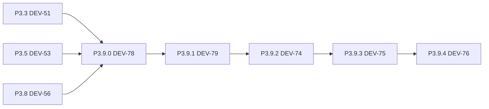

# MarkSharc Launch Plan

> **For agentic workers:** this plan covers four pull requests, one per Linear issue. Before starting an entry, write its task-level plan to `specs/DEV-<id>-PLAN.md`, then implement task by task with a spec for every behaviour change.

**Goal:** Open a terminal session on any host, in a directory, a repository, or a new `cwf` worktree, under whichever multiplexer is in use, and close it again when the work is merged.

**Authority:** [MARKSHARC-SPEC.md](MARKSHARC-SPEC.md) first, then [LAUNCH-SPEC.md](LAUNCH-SPEC.md). This plan argues from both; section numbers below refer to LAUNCH-SPEC unless they name the other document.

**Program plan:** [MARKSHARC-PLAN.md](MARKSHARC-PLAN.md) lists these entries as P3.9.0 to P3.9.4. Its global constraints apply to every entry here.

**Tracking:** Linear project MarkSharc, milestone 3. Modernization.

## Outcome of the review (P3.9.0, DEV-78)

DEV-78 reviewed DEV-74, DEV-75, and DEV-76 as one design. It changed four things.

| Finding | Effect |
|---|---|
| No multiplexer passes the caller's environment to a new terminal, and `hc run` has no environment option. | Launch metadata is passed explicitly; on `hc` through an `env` wrapper (4.2, 5.4, 7.1). |
| A terminal started with `hc` is hidden from the Herdr app unless it carries `herdr.space`, and `herdr-app` only reaches a window on the same host. | A placement model with defined fallbacks, and live checks before the command is built (5.4, 4.6). |
| Each multiplexer keeps its own machine list, beside `hosts.conf`. | Host-to-machine resolution in the foundation (5.2). |
| `cwf-new` hooks register during interactive init, so a non-interactive remote run would skip them. | Launch, then create: the new terminal runs `cwf-new` itself (9.1). This needs run-after-init (6.4) and removes the need to pass `cwf` exports or run setup over ssh. |

Functionality the three issues did not anticipate, and where it lands:

| Need | Entry |
|---|---|
| A shared picker and JSON helpers | P3.9.1 |
| Host resolution across three machine lists | P3.9.1 |
| Placement and its fallbacks for the Herdr app | P3.9.1 |
| `--env`, `--in-shell`, and run-after-init | P3.9.2 |
| A remote repository inventory over ssh | P3.9.3 |
| The `exit` directive and the `LAUNCH_WORKTREE` marker | P3.9.4 |

Operator decisions are in LAUNCH-SPEC section 13.

## Boundaries

| Entry | Issue | Title | Estimate | Depends on |
|---|---|---|---|---|
| P3.9.0 | DEV-78 | Spec and plan the launch, repo, and cwf-new work | 3 | P3.3, P3.5, P3.8 |
| P3.9.1 | DEV-79 | Launch foundation: pickers, host resolution, and mux launch adapters | 3 | P3.9.0 |
| P3.9.2 | DEV-74 | Add the launch-session command | 3 | P3.9.1 |
| P3.9.3 | DEV-75 | Add the launch-repo command | 3 | P3.9.2 |
| P3.9.4 | DEV-76 | cwf-new and gwt-clean in launched sessions | 3 | P3.9.3 |

The entries run in order. Inside P3.9.3, `repo-list` needs only the picker from P3.9.1, so it can be drafted while P3.9.2 is in review.

DEV-74 and DEV-75 each asked for a `specs/DEV-<id>-PLAN.md` holding the design. The design is in LAUNCH-SPEC instead; those files hold the task-level plans.

## Pull requests

### P3.9.1 — Launch foundation (DEV-79)

- **Repo:** marksharc
- **Estimate:** 3
- **Depends on:** P3.9.0 (DEV-78)
- **Spec:** 4, 5.1 to 5.4

**Goal:** Give the launch commands one picker, one answer for where a host is, and one way to ask a multiplexer for a terminal.

**Scope**

- `core/zsh/lib/pick.zsh` with `_ms_pick` (5.3). Move `marksharc hosts populate` onto it.
- `core/zsh/lib/json.zsh`: the reader extracted from `core/cli/hosts-lib.zsh`, extended to the `herdr machine list`, `hc get`, `hc run`, and Herdr creation replies, plus the argv encoder.
- Host resolution in `core/cli/hosts-lib.zsh`: reserved names, ssh targets, and machine matching (5.2).
- The `supports`, `current`, `instances`, `machines`, and `launch` operations in the `tmux`, `herdr`, and `herdr-core` adapters, with the placement fallbacks and `dry_run` (5.4). `marksharc-mux` dispatches them.
- Run checks V1 to V10 (4.6) with the operator present for the ones that change the app window. Record each result in LAUNCH-SPEC and amend 5.4 where a result requires it.
- Add the launch operations to `docs/MUX-ADAPTERS.md`.

**Tests**

- The adapter contract spec, extended to the new operations with stub CLIs that record their argv.
- Dry-run goldens for each adapter by placement and by local or remote.
- Picker specs: `gum`, `fzf`, neither, no terminal, cancel.
- A regression spec for `marksharc hosts populate`.
- JSON reader specs against captured output shapes.

**Done when**

- A request sent through `marksharc-mux launch` opens a terminal in tmux, the Herdr TUI, and Herdr Core on the Mac and on sol.
- Every row of the table in 4.6 has a result.
- `tests/check` is green on macOS and Ubuntu.

**Notes:** Do not experiment in a live Herdr window without the operator. A check that fails is a finding, not a blocker: record it and keep the fallback.

### P3.9.2 — launch-session (DEV-74)

- **Repo:** marksharc
- **Estimate:** 3
- **Depends on:** P3.9.1 (DEV-79)
- **Spec:** 5.5, 6, 7, 10

**Goal:** One command that opens a terminal session on a chosen host and directory, usable by people and by automation.

**Scope**

- The `launch` module: `module.conf` with the options in section 10, and `bin/launch-session`.
- Both syntax forms on one parser (6.1), the result line and statuses (6.2), and the command modes (6.3).
- Multiplexer, instance, and machine selection (5.5).
- The metadata variables and the carried forwarding variables (7.1).
- Run-after-init in `init.zsh` and `init.fish` (6.4).
- `setup-ssh-agent` and `setup-x11-display` read the parent values (7.2).
- zsh and fish completions: options, hosts from `hosts.conf`, and kinds.
- `docs/launch.md`, the README command list, the module catalog, the contract inventory, and `CHANGELOG.md`.

**Tests**

- Parser specs for both forms, their conflicts, and every exit status.
- Selection specs for every branch of 5.5.
- Dry-run goldens for the full argv, with awkward values.
- Run-after-init specs in zsh and fish, including batch and agent sessions.
- Startup specs for a usable, a dead, and an other-host parent value.

**Done when**

- From a terminal in the Herdr app on the Mac, `launch-session <host>:~/dir` opens a space on sol in that directory.
- From a shell on sol shown by that app, `launch-session ~/dir` opens a visible terminal on sol.
- The same command works in tmux and in the Herdr TUI.
- An agent with no terminal can launch with flags only, and an ambiguous request exits 3.
- A session launched locally reuses the caller's agent socket and DISPLAY.

### P3.9.3 — launch-repo (DEV-75)

- **Repo:** marksharc
- **Estimate:** 3
- **Depends on:** P3.9.2 (DEV-74)
- **Spec:** 8

**Goal:** Open a session in a repository or worktree chosen by name or from a picker, on any host.

**Scope**

- `modules/git-worktree/bin/repo-list`: scan, worktree chain, cache, and freshness rules (8.2). Update the `git-worktree.roots` description.
- The remote inventory over ssh, with the ssh discipline of `marksharc push`.
- `modules/launch/bin/launch-repo`: both syntax forms, resolution (8.3), the picker, and the hand-off to `launch-session`.
- zsh and fish completions with repository and worktree names from the cache.
- Documentation, the contract inventory, and `CHANGELOG.md`.

**Tests**

- Inventory specs with disposable repositories and linked worktrees: every freshness rule and the cache header.
- Remote inventory specs with a stub `ssh`: success, timeout, and a host with no ssh target.
- Resolution specs: duplicates, worktree by directory and by branch, the path form, and the reserved creation form.
- The `launch-session` argv that `launch-repo` produces.

**Done when**

- `launch-repo <name>` opens a session in that repository on the Mac and on sol.
- `launch-repo` with no argument shows the picker; without a terminal it exits 3.
- `launch-repo <host>:<repo>/<worktree>` opens an existing worktree on the other host.
- A repository created after the last scan is found without `--rescan`.

### P3.9.4 — cwf-new and gwt-clean in launched sessions (DEV-76)

- **Repo:** marksharc
- **Estimate:** 3
- **Depends on:** P3.9.3 (DEV-75)
- **Spec:** 9

**Goal:** Create a `cwf` session in a new terminal on any host, and close that terminal when `gwt-clean` removes the worktree.

**Scope**

- The `exit` directive in the zsh and fish appliers, and in `docs/write-once.md` (9.3).
- `cwf-new` launch options, the hand-off to `launch-repo`, and `--launched` with `LAUNCH_WORKTREE` (9.1).
- `gwt-clean` launched mode (9.2).
- zsh and fish completions for the new `cwf-new` options.
- Documentation, the contract inventory, and `CHANGELOG.md`.

**Tests**

- Applier specs in zsh and fish: order, status validation, and file removal before the exit.
- `cwf-new` specs: the in-place path unchanged, the launch-mode argv, repository selection from the current directory, and `LAUNCH_WORKTREE` after `--launched`.
- `gwt-clean` specs: exit on a match; no exit on a failed step, an empty value, or another path.

**Done when**

- On the Mac, `cwf-new --repo <repo> --host <host> <branch>` opens a terminal on sol that creates the session, runs the overlay's post-create hooks, and ends in the worktree.
- `gwt-clean` in that terminal removes the worktree and branch and closes the terminal.
- In-place `cwf-new` and `gwt-clean` behave as before, including in a terminal that was launched into a base repository.

**Notes:** In-place `gwt-clean` keeps its current `cd` directive.

## Gates

| Gate | Check before moving on |
|---|---|
| After P3.9.1 | The table in 4.6 is complete and 5.4 matches it. The command is not built on an unverified placement. |
| After P3.9.2 | A few days of launching by hand on the Mac and sol, in the Herdr app and in tmux. |
| Before P3.9.4 | The overlay's post-create hooks are confirmed to run in a session started through run-after-init on sol. |

## Spec coverage

| LAUNCH-SPEC section | Delivered by |
|---|---|
| 4 Multiplexer behaviour | DEV-78 (review), DEV-79 (checks in 4.6) |
| 5.1 to 5.4 Parts, hosts, picker, adapters | DEV-79 |
| 5.5 Choosing the multiplexer | DEV-74 |
| 6 launch-session | DEV-74 |
| 7 Launch metadata | DEV-74 |
| 8 launch-repo | DEV-75 |
| 9 cwf-new, gwt-clean, and the exit directive | DEV-76 |
| 10 Configuration | DEV-74, DEV-75 |
| 11 Testing | Every entry |
