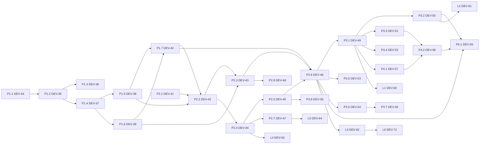

# MarkSharc Program Plan

> **For agentic workers:** this is the programme-level plan. Each entry below is one pull request and one Linear issue. Before starting an entry, write its task-level plan (superpowers:writing-plans), then execute it with superpowers:subagent-driven-development or superpowers:executing-plans.

**Goal:** Replace the shell support in `mark-desktop-files` with `marksharc`, a public, modular framework for zsh and fish with bash environment parity, without a day of broken shells on any host.

**Architecture:** A read-only framework repo, a user-owned overlay in `~/.config/marksharc`, and per-host cache and state. Functional areas are modules. Env is declared once and rendered per shell; interactive behaviour is native; complex commands are zsh executables with a small directive protocol.

**Tech stack:** zsh 5.9+, fish 4.x, bash 5.x (env only); ShellSpec 0.28.1; GitHub Actions on macOS and Ubuntu; atuin, starship, fzf, zoxide; git for distribution and sync.

**Spec:** [MARKSHARC-SPEC.md](MARKSHARC-SPEC.md). The plan argues from the spec; read both.

**Tracking:** Linear project MarkSharc, team Development. Planning issue DEV-33. Milestones match the phases below.

## Global constraints

- macOS and Linux are both supported in every PR. Native Windows is not a target.
- Day-to-day shell use requires only the native shell. `marksharc` CLI commands require zsh.
- Shell startup is quiet, offline, and makes no installs. Batch and agent sessions print nothing.
- A missing optional tool or directory never breaks startup.
- Portable code contains no personal values (user, host, org, or site names; home paths). They come from the overlay.
- The framework checkout is never written to at run time. State goes to `~/.cache/marksharc` and `~/.local/state/marksharc`.
- No agent configuration is committed to `marksharc` (`AGENTS.md`, `CLAUDE.md`, `.claude/`, `.agents/`, `.omp/`, `.cwf*` stay ignored). The workflow tool is `cwf`, not `cwft`.
- Every behaviour change ships with a spec. Tests use a temporary HOME and command stubs, never real services.
- Config files use the line-directive format from spec section 6.5. No TOML or YAML parser is required on a host.
- Each PR leaves the author's hosts working. Changes land on the Mac first, then sol.

## Phases

| Phase | Repo | Outcome | Issues |
|---|---|---|---|
| 1. Pre-migration | mark-desktop-files | zsh runs in the target module layout, without Oh-My-Zsh, in place | DEV-34, DEV-35, DEV-36, DEV-37, DEV-38, DEV-39, DEV-40 |
| 2. MVP | marksharc | Every regular host runs zsh from `marksharc` | DEV-41, DEV-42, DEV-43, DEV-44, DEV-45, DEV-46, DEV-47, DEV-48 |
| 3. Modernization | marksharc | Rendered env, bash env, write-once commands, Day 0 / Day 2 commands, multiplexers, upgrades, push sync | DEV-49, DEV-50, DEV-51, DEV-52, DEV-53, DEV-54, DEV-55, DEV-56 |
| 4. Fish | marksharc | Fish on the same structure | DEV-57, DEV-58 |
| 6. Cleanup | mark-desktop-files | No shell code left outside the overlay | DEV-59 |
| 5. Later | marksharc | Unscheduled candidates | DEV-60, DEV-61, DEV-62, DEV-63, DEV-64, DEV-72 (L6) |

Rough size: 95 estimate points across 26 scheduled PRs, plus 6 unscheduled candidates.

## Dependencies

**Critical path to MVP:** P1.1 → P1.2 → P1.4 → P1.5 and P1.6 → P1.7 → P2.2 → P2.3 → P2.5 → P2.6.

**Parallel work:**

- P2.1 (repo scaffold and CI) has no dependency on Phase 1 and can start at once.
- P1.3 (history) runs beside P1.4 once P1.2 has merged.
- P1.5 and P1.6 split the interactive file by area and can run side by side. They both delete from `zsh.zshrc.interactive`, so merge one, rebase the other.
- P2.4 and P2.7 run beside P2.3. P2.8 follows P2.3.
- After cutover (P2.6): P3.1, P3.5, and P3.6 are independent of each other. P3.2, P3.3, P3.4, and P4.1 all wait on P3.1.

## Gates

| Gate | Check before moving on |
|---|---|
| After P1.2 | A week of normal use on the Mac without Oh-My-Zsh, then sol. This is the highest behaviour risk. |
| After P1.7 | The portable tree passes the personal-value lint. Nothing public moves before this. |
| Before P2.6 | CI is green on macOS and Ubuntu; `marksharc doctor` is clean on the Mac from a dev checkout. |
| After P2.6 | One week on the Mac and sol from the new repo without a rollback. Then Modernization starts. |
| After P3.1 | PATH and env are byte-identical before and after rendering on both hosts. |
| Before P6.1 | Every host that is still in use has been cut over. |

## Host rollout order

1. The Mac (MarkMBM5): every change lands here first.
2. sol: the Linux reference host.
3. The other regular hosts, by `marksharc sync` once P2.5 exists.
4. Occasional hosts, when next visited; P3.8 removes the need to visit.

Rollback at any point before P6.1: `marksharc uninstall` restores the previous stubs, and `mark-desktop-files/config/zsh` is still present.

## Pull requests

### Phase 1: Pre-migration

#### P1.1 — Prune dead and abandoned zsh code (DEV-34)

- **Repo:** mark-desktop-files
- **Estimate:** 2
- **Depends on:** DEV-33

**Goal:** Remove everything on the planned-abandonment list that does not depend on Oh-My-Zsh, so later PRs restructure less code.

**Scope**

- Delete legacy OS branches from `zsh.common` and `build_path`: Solaris, SunOS, FreeBSD, Ascend, iserver; X and OpenWindows dirs; quirk dirs; legacy MANPATH dirs.
- Delete Google and Manifest logic: `gcert`, `unlock_gnubby`, `g4d`, the history forwarder, `etc/zsh.gcp-mcp`, `etc/zsh.manifest-cloud`.
- Delete CVS and Perforce helpers and env, rbenv init, the xemacs fallback, and the `mroe` and `us` aliases.
- Delete `zsh.zshrc.reference.dont` and its `ZSH_SKIP_REFERENCE` branch, `mdf-switch`, `setup-terminal`, and the install-hint text blocks.
- Make `.bashrc` silent (remove the echo).
- Trace the `_encode: command not found` leak seen in agent shells and the `GOROOT` vs Homebrew `go` mismatch. Fix here if the cause is in pruned code; otherwise record the cause on P1.4 or P1.5.

**Tests**

- Existing ShellSpec suite stays green.
- New specs assert the removed names are undefined after startup.
- `environment_spec` updated for the trimmed path matrix.

**Done when**

- `tests/shell/run-tests --shell zsh spec/zsh` passes.
- Interactive startup on the Mac and sol shows no new errors.
- A before/after capture of `print -l $path` differs only by removed legacy directories.

#### P1.2 — Remove Oh-My-Zsh (DEV-35)

- **Repo:** mark-desktop-files
- **Estimate:** 5
- **Depends on:** P1.1 (DEV-34)

**Goal:** Run zsh with no Oh-My-Zsh, keeping the four behaviours chosen in the interview and starship as the only prompt.

**Scope**

- Delete `zsh.zshrc.ohmyzsh`, `etc/oh-my-zsh/`, `etc/links/*.zsh-theme`, p10k sourcing, `etc/zsh_plugins.txt`, the COMPFIX exports, and the OMZ-conditional kubectl and gcloud branches.
- Add the built-in pinned plugin loader. It clones only on an explicit command and never at startup. Load fzf-tab through it.
- Run native `compinit` with its dump in the cache dir. Keep the live zstyles; drop the dead ones.
- Add native replacements: Alt-arrow directory navigation widgets, coloured man pages, and a command-not-found handler for Homebrew and apt.
- Remove prompt leftovers (`OPS1`, `VCPS1`, vcs_info block).
- Stop writing `.zcompdump*` into `config/zsh`.

**Tests**

- Startup spec with no `~/.oh-my-zsh` present.
- Plugin loader specs: a missing clone is skipped silently; the pinned commit is checked out; the `git` stub is never called during startup.
- Specs for widget and handler existence and for the compdump location.

**Done when**

- A fresh interactive shell works with `~/.oh-my-zsh` moved aside.
- Tab completion with fzf-tab, Alt-arrows, man colours, and command-not-found are checked by hand on the Mac, then sol.
- Startup time before and after is recorded in the PR.

**Notes:** Highest behaviour risk in the programme. Keybinding and completion feel cannot be tested from history. Rollback is a single revert.

#### P1.3 — Atuin-only history and legacy import (DEV-36)

- **Repo:** mark-desktop-files
- **Estimate:** 3
- **Depends on:** P1.2 (DEV-35)

**Goal:** Make atuin the only history store and bring the old history files into it.

**Scope**

- Remove the history option block and the `HIST*` and `DIRHIST*` exports. Unset `HISTFILE`; keep in-memory history for `!!` and recall.
- Define `history` and `h` over `atuin history list` with pipe-friendly output. Fall back to the builtin when atuin is absent.
- Add a small native-history fallback (one file under the state dir) for hosts without atuin.
- Write an import script with a dry-run mode: `~/.zsh_history`, `~/.zhistory`, `$ZDOTDIR/.zsh_history`, and the per-directory trees. Spike first on preserving each entry's directory; fall back to importing without it.
- Run the import on the Mac (including the `*-sol` copies) and on sol.
- Remove the history lines from `.gitignore` once nothing writes history into the repo.

**Tests**

- History wrapper specs with an atuin stub.
- Import script specs on fixture files: extended-history format, multi-line entries, a per-directory tree, duplicates.
- A spec that no history file is written under a temporary HOME.

**Done when**

- `history | egrep <pattern>` works.
- `atuin stats` reflects the imported entries.
- No history file grows in the repo or in HOME after a session.

**Outcome:** Delivered in [PR #11](https://github.com/markfrommn/mark-desktop-files/pull/11), pending human merge. The spike chose the histdb route: a temporary zsh-histdb database imported with `atuin import zsh-hist-db` keeps each entry's directory, timestamp, duration and host label, with plain `atuin import zsh` (no directories) when `sqlite3` is missing. The Mac and sol imports are an operator step after the dry run; pick one route and stay on it, because switching routes can duplicate rows.

#### P1.4 — Zsh core loader and session classes (DEV-37)

- **Repo:** mark-desktop-files
- **Estimate:** 5
- **Depends on:** P1.2 (DEV-35)

**Goal:** Replace the sentinel-driven startup chain with the target core: env and init phases, session classes, a module loader, and quiet startup.

**Scope**

- Create `config/zsh/core/` mirroring the target `core/zsh` (`zshenv.zsh`, `zprofile.zsh`, `zshrc.zsh`, `lib/`). `~/.zshenv` becomes a stub that sources it. `ZDOTDIR` is a generated directory under the state dir.
- Classify the session as `interactive`, `agent`, or `batch` in `MARKSHARC_SESSION`, replacing `interactive_shell`.
- Split the env phase from the init phase. Export the `MARKSHARC_ENV` marker. Re-assert PATH in `.zprofile`.
- Compute host facts with builtins; keep the old names as compatibility variables.
- Add the module loader: module list and options from `config.conf`; metadata from `module.conf` (`describe`, `requires`, `order`, `option`); load `env.zsh` and `init.zsh`; set up function autoload and completion paths.
- Add `_ms_init_cached`. Make startup silent. Add the verbose trace; `cs` and `li` become verbose reloads. Remove the PID sentinels and `zdo_*` flags.
- Rename `_mdf_*` to `_ms_*`. Keep `MDF_BASE` as a compatibility export.
- Wrap the not-yet-split interactive file in one transitional `legacy` module so the shell keeps working until P1.5 and P1.6 land.
- Check by hand how Claude Code and Codex load rc files with `ZDOTDIR` redirected; record the result in the PR.

**Tests**

- Contract specs: `zsh -c` and `zsh -ic` under agent markers produce no output; a PTY session gets the init phase.
- Specs for double-source idempotency, load order, `requires` skips, the mtime-keyed cache, and reload.

**Done when**

- The Mac runs on the new loader for two days.
- Agent sessions show no stray output.
- Startup time is no worse than after P1.2.

**Notes:** Can proceed in parallel with P1.3.

#### P1.5 — Restructure zsh into modules: environment and tools (DEV-38)

- **Repo:** mark-desktop-files
- **Estimate:** 5
- **Depends on:** P1.4 (DEV-37)

**Goal:** Split the environment and tool half of the interactive file and `build_path` into modules.

**Scope**

- Modules: `path`, `brew`, `zsh-options`, `editor`, `pager`, `ls`, `ps`, `nav`, `zoxide`, `completion`, `completion-fzf-tab`, `command-not-found`, `history-atuin`, `history-native`, `prompt-starship`, `node-nvm`, `go-gvm`, `python`, `bun`, `pnpm`, `rust`, `go`, `lmstudio`, `cuda`, `direnv`, `greeting`.
- Replace `build_path` with the tiered builder. The default tier order must reproduce today's PATH.
- Fix the ps helpers: keep the header without grep false matches; one implementation for macOS and Linux. Tidy the `ls` family.
- Make `GOROOT` consistent with the selected Go in `go-gvm`.
- Give each module its `module.conf` metadata.

**Tests**

- Per-module specs.
- PATH golden tests from directory-layout fixtures for macOS and Linux.
- ps helper specs against stubbed `ps` output.
- The existing nvm and gvm hook specs, moved.

**Done when**

- The `legacy` module holds no environment or tool code.
- PATH on the Mac and sol matches the pre-change capture except for documented removals.

**Notes:** Can proceed in parallel with P1.6.

**Notes for the implementer (from DEV-37):**

- The loader checks `requires command` once, before any module's `env.zsh` changes PATH. A module that needs a Homebrew-installed tool can be skipped in a minimal-PATH shell unless `brew` loads first or the check moves after the env phase.
- In the `legacy` module, `build_path` activates gvm and detects Go only when `MARKSHARC_SESSION` is `interactive`, and never passes `--default`. Agent and batch shells get gvm's Go by PATH only: the default environment's `gvm_go_name`, read with builtins, or the newest `~/.gvm/gos/go*`, with no sourcing and no forks. Keep that split in `go-gvm`.
- Fortune is opt-in through `set legacy.greeting on`; carry that option to the `greeting` module.

**Outcome:** Delivered in [PR #13](https://github.com/markfrommn/mark-desktop-files/pull/13), pending human merge; task plan [2026-11-20-dev-38-zsh-env-tool-modules.md](../docs/superpowers/plans/2026-11-20-dev-38-zsh-env-tool-modules.md). Operator decision: version-manager paths (gvm, nvm, pyenv shims) go in a new `manager` tier ahead of `brew` in every session class, a deviation from the old 6.7 order now written into the spec. One builtin Go selector serves every session class (gvm's default environment, else the newest Go), and `GOROOT` follows the first `go` on PATH. Intended PATH changes on the Mac: nvm's default node first in batch, agent and login shells; `~/.bun/bin` and `~/Library/pnpm` in the `user` tier; interactive shells on the default Go instead of the next-newest. `requires command` is checked at each module's turn against the live PATH plus pending tier directories.

**Notes for the implementer (from DEV-38):**

- The `legacy` module (order 99) and the trimmed `zsh.zshrc.interactive` hold only system, workflow and personal code. P1.6 deletes both.
- The `dot_in_path` option is `path.dot_in_path`, default on, to reproduce today's PATH. P1.7 renames it to `core.dot_in_path` with the default off and the overlay setting it on.
- Fortune is now `set greeting.fortune on`; the old `legacy.greeting` key is gone.
- Personal PATH entries still added from the transitional `mark-tools` module (`~/etc/<user>-desktop-files` bin and scripts, sandcat, gam, envman) and `/opt/dell` in the `local` list move or go in P1.7.
- Check by hand on sol: the Linux tier order and Linuxbrew placement (option `brew.linuxbrew_tier`), the CUDA `/dev/nvidiactl` probe, the ps flags under procps, and nvm alias resolution.

#### P1.6 — Restructure zsh into modules: system and workflow (DEV-39)

- **Repo:** mark-desktop-files
- **Estimate:** 5
- **Depends on:** P1.4 (DEV-37)

**Goal:** Split the system helpers and workflow integrations into modules and delete the old startup files.

**Scope**

- Modules: `agent`, `ssh-agent`, `x11`, `docker`, `mux`, `titles`, `herdr`, `wezterm`, `cc-providers`, `git-worktree`, `cwf`, `fish-bridge`.
- Move cached agent state from `~/tmp/private` to the state dir, migrating the existing file.
- Parameterise: `repo-sync` takes `roots` and `orgs` options; `cwf-new` gets a post-create hook point; `gwt-clean` gets a pre-remove hook point.
- Remove the one-second sleep from `x11`.
- Keep `install-krew`, `install-gvm`, and `install-wezterm-terminfo` as functions in their modules until `marksharc install` exists.
- Delete the `legacy` module and `zsh.zshrc`, `zsh.login`, `zsh.common`, `zsh.functions`, `zsh.zshrc.interactive`.

**Tests**

- Move the existing specs (agents, cleanup, cwf, sync, titles, wrappers) beside their modules.
- New specs for the hook points and the state-file migration.

**Done when**

- `config/zsh` contains only `core/`, `modules/`, and stubs.
- All specs pass.
- `cwf-new`, `gwt-clean`, `claudek`, and `collie-default` are checked by hand on the Mac.

**Outcome:** Delivered in [PR #14](https://github.com/markfrommn/mark-desktop-files/pull/14), pending human merge; task plan [2026-11-20-dev-39-system-workflow-modules.md](../docs/superpowers/plans/2026-11-20-dev-39-system-workflow-modules.md). The twelve modules plus `cloud` (`install-krew`) hold the system and workflow code. Three transitional modules, `convoy`, `mdf` and `mark-tools`, hold the personal code that P1.7 moves. The `legacy` module and every old `zsh.*` file are gone, so `config/zsh` holds `core/`, `modules/`, and the `.zshenv.linux` and `.zshenv.mac` stubs. The ssh-agent cache is `$XDG_STATE_HOME/marksharc/ssh-agent/agent.<host>.sh`; the old `~/tmp/private` file moves there once, and a symlinked, foreign or group/world-writable source is refused. `cwf-new` runs `cwf_new_post_create_hooks` and `gwt-clean` runs `gwt_clean_pre_remove_hooks`; a failing or undefined hook stops the command and keeps the session or worktree. Operator decision: the 6.4 band 90–99 is last-running init (`titles` 90, `x11` 91, `ssh-agent` 93), with 95 and above kept for line-editor plugins, so `greeting` moved from 98 to 94. The hand checks on the Mac are an operator step after merge.

#### P1.7 — Carve out the private overlay (DEV-40)

- **Repo:** mark-desktop-files
- **Estimate:** 3
- **Depends on:** P1.5 (DEV-38), P1.6 (DEV-39)

**Goal:** Separate personal content from portable code, so the portable tree can go public.

**Scope**

- Create `marksharc/` at the repo root: `config.conf`, `hosts/<host>.conf` for current hosts, `modules/convoy`, `modules/site-bac`, `modules/mark-tools`, `providers/`, `packages/`, `local/post.zsh`.
- Have the loader read `$MARKSHARC_CONFIG` (`~/.config/marksharc`, a link) and the private module directory.
- Move personal values out of the portable modules: work roots, the org list, the `core-platform` hook, BAC and Plesk code, gam, sandcat, envman, provider files.
- Set `core.dot_in_path on` in the overlay.
- Delete `etc/zsh.zshrc.user`.

**Tests**

- A lint spec that fails when the portable tree contains personal values (user name, home paths, org names, site names).
- Overlay specs: host file override, private module directory, option setting.
- The `core-platform` hook spec, moved from the cwf spec.

**Done when**

- The portable tree passes the personal-value lint.
- The overlay link exists on the Mac and sol.
- Behaviour is unchanged.

**Repository outcome (DEV-40):** Prepared in [PR #16](https://github.com/markfrommn/mark-desktop-files/pull/16), pending human review and merge. The private overlay and portable-tree lint are implemented. Hermetic zsh tests exercise the loader, private modules and startup; they do not certify behavior on an installed host. The Mac and sol links and their installed checks remain pending after human merge. Linux runtime and real CWF/provider integrations remain unverified by this change. See [the overlay guide](../docs/marksharc-overlay.md).

**Notes for the implementer (from DEV-37):**

- Module selection today: with no `config.conf`, every module present loads. If `config.conf` has any `module <name>` line, only the listed modules load. If it has only `set` or `module <name> off` lines, everything loads except the `off` modules. Confirm or change this when the overlay arrives.
- The loader reads one module root, `config/zsh/modules`. `_ms_module_roots` must gain the overlay's `modules/` directory.
- The Plesk `dname=plesk-phorn` mapping lives in `modules/mark-tools/env.zsh`; it moves to the overlay's `site-bac` module.

**Notes for the implementer (from DEV-39):**

- The personal code waits in three transitional modules. `convoy` (41) sets `git-worktree.roots` and `git-worktree.orgs`, finds `COMMON_DEV_TOOLS`, and registers the `core-platform` `cwf-new` hook first. `mdf` (40) exports `MDF_BASE`/`MDF_REL`, points `cc-providers.dir` at `$MDF_BASE/ai/providers`, and creates the `~/tmp/private/sockets` ssh ControlPath directories once per shell. `mark-tools` (60) holds sandcat, gam, envman, the Plesk mapping, the desktop-files bin directories, and the `etc/zsh.zshrc.user` source.
- `mark-tools` sits at 60 so its bin directories land after every other `user`-tier contributor (`go`, `rust`, `bun`, `pnpm`); `system_modules_spec` asserts that env order. Keep the overlay module after them.
- `etc/zsh.zshrc.user` now runs before the `titles` `cd .` kick, `x11` and `ssh-agent`; it used to run after the kick and x11.
- `modules_spec`'s personal-value check exempts the three transitional modules; the P1.7 lint replaces it.

### Phase 2: MVP

#### P2.1 — Repo scaffold, conventions, and CI (DEV-41)

- **Repo:** marksharc
- **Estimate:** 3
- **Depends on:** DEV-33

**Goal:** Make the new repo ready to receive code, with CI on both platforms from the first PR.

**Scope**

- Create the layout from spec section 6.2, with `memories/`, `specs/`, and `docs/`.
- Add a README skeleton and CHANGELOG; review `.gitignore` against the agent-config rule.
- Create a local, untracked `.cwf-settings.yaml` and render it by hand; document the steps in `docs/DEVELOPING.md`.
- Copy the test harness (runner wrapper, pinned ShellSpec, support files).
- Add a GitHub Actions workflow on `macos-latest` and `ubuntu-latest`: install zsh, fish, and ShellSpec at a pinned commit; lint with `zsh -n` and shellcheck (sh and bash files); run the suite.
- Copy the spec and plan into `specs/`.

**Tests**

- A smoke spec and the lint job pass on both runners.

**Done when**

- The PR merges with green CI on macOS and Ubuntu.
- The `cwf` workflow is usable in the repo.

**Notes:** No dependency on Phase 1; can start immediately.

#### P2.2 — Move the core and the environment and tool modules (DEV-42)

- **Repo:** marksharc
- **Estimate:** 3
- **Depends on:** P1.5 (DEV-38), P1.7 (DEV-40), P2.1 (DEV-41)

**Goal:** Bring the core loader and the first module batch into the new repo, tested on both platforms.

**Scope**

- Copy `config/zsh/core` to `core/zsh` and the P1.5 modules to `modules/`, with their specs. Record the source commit in the commit message.
- Add the cross-shell contract suite to CI.
- Fix what the first Linux CI run exposes.
- `mark-desktop-files` keeps running from its own copy until cutover.

**Tests**

- All moved specs and the contract suite pass on macOS and Ubuntu.

**Done when**

- A shell started with `MARKSHARC_HOME=/data/work/mark/marksharc` loads the environment and tool modules on the Mac.

**Outcome:** Delivered in [PR #2](https://github.com/markfrommn/marksharc/pull/2), pending human review and merge. Source revision `dcdb605a36bdf821b39eddd5f0bd2095bc7ec81d`. The zsh core loader lives at `core/zsh` and the 26 P1.5 environment and tool modules at `modules/`, with the moved zsh suites, the cross-shell contract suite wired into CI, the repo hygiene suite and the personal-value lint over the portable tree. Final independent local gate counts: lint 50 files; zsh 198/198; contract 4/4; repo 26/26. The first Ubuntu run exposed competing global and insecure-directory `compinit` prompts plus a non-hermetic no-Go fixture; the fix makes the completion module the sole audited, non-interactive owner and the fixture independent of `/usr/bin`. Hosted run [44899859687](https://github.com/markfrommn/marksharc/actions/runs/44899859687) passed every check on macOS and Ubuntu at `5aaf370`; CI continues to verify each exact PR head. A shell started with the literal installed path `MARKSHARC_HOME=/data/work/mark/marksharc` remains an operator check after merge; the pre-merge runtime checks used this worktree with an isolated HOME. Follow-up DEV-65 records the legacy history import executable and its specs, deliberately not moved with this unit.

#### P2.3 — Move the system and workflow modules (DEV-43)

- **Repo:** marksharc
- **Estimate:** 3
- **Depends on:** P1.6 (DEV-39), P2.2 (DEV-42)

**Goal:** Bring the second module batch into the new repo.

**Scope**

- Copy the P1.6 modules and their specs.
- Confirm the personal-value lint passes in the public repo.
- Fix Linux-only failures.

**Tests**

- All moved specs pass on macOS and Ubuntu.

**Done when**

- A shell started from the new repo with the overlay behaves the same as the in-place version on the Mac.

**Outcome:** Delivered in [PR #3](https://github.com/markfrommn/marksharc/pull/3), pending human review and merge; task plan [2026-11-21-dev-43-move-system-workflow-modules.md](../docs/superpowers/plans/2026-11-21-dev-43-move-system-workflow-modules.md). Source revision `4f8469cf1544347e342289cf7d9f5bf1c29fa7e0` (origin/main). The 13 system and workflow modules (agent, ssh-agent, x11, docker, mux, titles, herdr, wezterm, cc-providers, git-worktree, cwf, fish-bridge, cloud) live at `modules/` with their module-local specs linked from `tests/spec/zsh/modules/`; `system_modules_spec` moved with the author's private-overlay assertions reproduced against a synthesized overlay with neutral values. The P1.6 coverage DEV-42 trimmed from the shared specs is restored the same way. Two source-state defects were exposed by the moved specs and resolved with failing evidence first: `cwf_spec` now pins the PR #18 codegraph reindex gate (init only when the session carries `.codegraph/.gitignore`; new `no-index` example), and `cleanup_spec` resolves a merge conflict committed upstream in PR #17 to the side that matches `gwt-clean`'s current invocations and the spec's `no-env` mode. `provider_cli_spec` did not move: it tests the source's `bin/model-test-provider.sh`, which has no destination in this layout (same treatment as DEV-42's `history_import_spec`). Final local gate counts on Linux: lint 57 files; zsh 304 examples, 0 failures, 1 platform skip; contract 4/4; repo 26/26; personal-value lint green over the enlarged portable tree. The final Mac in-place comparison is **unverified**: it cannot run from the Linux worktree and remains a manual acceptance step after merge. Hosted macOS and Ubuntu CI pass on PR #3.

#### P2.4 — Installer, stubs, and CLI base (DEV-44)

- **Repo:** marksharc
- **Estimate:** 3
- **Depends on:** P2.2 (DEV-42)

**Goal:** Provide the Day 0 path and the `marksharc` command.

**Scope**

- Write `install.sh` in POSIX sh with `--home`, `--overlay`, and `--dry-run`. It backs up existing dotfiles with a manifest, writes the zsh stubs, and is safe to re-run.
- Write `bin/marksharc` with `reload`, `module list|enable|disable`, `uninstall`, and `version`.
- Add `templates/overlay/`.
- Add the safe fallback: if the core fails to load, set a minimal PATH and print one error line.

**Tests**

- Installer specs in a temporary HOME: fresh install, existing dotfiles, idempotent re-run, uninstall restores.
- CLI specs.
- A spec for the load-failure fallback.
- shellcheck on `install.sh`.

**Done when**

- A clean macOS account or Linux container reaches a working shell with the template overlay from the README command.

**Outcome:** Delivered in [PR #4](https://github.com/markfrommn/marksharc/pull/4), pending human review and merge; task plan [2026-11-21-dev-44-installer-stubs-cli-base.md](../docs/superpowers/plans/2026-11-21-dev-44-installer-stubs-cli-base.md).

- **Installer and stub:** `install.sh` (POSIX sh) uses `--home`, else its own checkout, else clones into `${XDG_DATA_HOME:-~/.local/share}/marksharc` (`MARKSHARC_REPO` overrides the source). It moves all five HOME zsh dotfiles into a manifest-backed backup and writes a single `~/.zshenv` stub, which falls back to a minimal PATH and one stderr line when the core fails to load. It never runs `chsh`.
- **CLI:** `marksharc` provides `version`, `module list|enable|disable` and `uninstall [--purge]`; `reload` is an interactive-shell function, so module file-scope declarations now use `-g` (spec 6.4). These installer choices were made by the operator in the phase session.
- **Gates:** local gates on macOS: lint 66 files; zsh 331, contract 4, install 40, repo 26 examples, 0 failures.
- **Day 0 verification:** `tests/e2e/install-e2e.sh` passes in a `debian:stable-slim` container for both the `--home` and the piped clone installs, and CI runs it on macOS and Ubuntu. The literal README `curl … | sh` command remains a manual check once the repository is public; it is private today.

#### P2.4.1 — Enhance installer (DEV-71)

Extend P2.4 with the remaining Bash login-file backups and opt-in Fish
configuration cleanup. The [DEV-71 plan](DEV-71-PLAN.md) covers migration,
rollback, and verification on clean and existing accounts.

#### P2.5 — Sync and doctor (DEV-45)

- **Repo:** marksharc
- **Estimate:** 3
- **Depends on:** P2.4 (DEV-44)

**Goal:** Deliver cross-host pull with a behind-notice, and the health check.

**Scope**

- `marksharc sync`: framework, overlay, and extra repos; fast-forward only; report dirty, ahead, or diverged trees without touching them; then fetch pinned plugins and refresh caches.
- Notify: a throttled detached fetch, a status file, and a one-line notice in the next shell.
- `marksharc doctor`: stubs and links, missing commands for enabled modules, plugin clones, repo state, foreign lines in dotfiles, duplicate PATH entries, startup time against a budget.
- A minimal `marksharc update` (sync plus plugin pins). The full updater is P3.4.

**Tests**

- Sync specs against local bare repositories: clean fast-forward, dirty tree, diverged, offline.
- Notify throttle specs.
- One doctor spec per check, with fixtures.

**Done when**

- A change pushed from the Mac reaches sol with one `marksharc sync`.
- sol shows the behind-notice before syncing.

**Outcome:** Implemented in [PR #5](https://github.com/markfrommn/marksharc/pull/5),
pending human merge. DEV-45 adds fast-forward-only sync, pinned plugin refresh, a
throttled detached behind check, minimal update, and doctor diagnostics. Local
bare-repository tests exercise a pushed change, a subsequent PTY notice and sync;
the actual Mac-to-sol transfer and notice remain unverified on those hosts.
The renderer remains P3.1; MVP refreshes the existing caches and environment ID.

#### P2.6 — Cutover: run hosts from marksharc (DEV-46)

- **Repo:** mark-desktop-files and marksharc
- **Estimate:** 3
- **Depends on:** P1.7 (DEV-40), P2.3 (DEV-43), P2.5 (DEV-45)

**Goal:** Meet the MVP success criterion: zsh sessions run from the new repo on every regular host.

**Scope**

- Switch the overlay to consume the public modules; private modules stay in the overlay.
- Run `install.sh` on each host; it replaces the `~/.zshenv` link and supersedes `link-cleanup` and `mdf-sync`.
- Convert the foreign lines `doctor` finds (pnpm, Docker Desktop, JetBrains Toolbox, Codex, `~/.local/bin`) into modules or overlay lines.
- Roll out in order: Mac, sol, the other regular hosts, then occasional hosts as they are visited.
- Document rollback: `marksharc uninstall` restores the previous stubs; `config/zsh` stays in `mark-desktop-files` until Phase 6.

**Tests**

- `marksharc doctor` is clean on each host.
- The contract suite passes when run locally on a macOS and a Linux host.

**Done when**

- Every regular host runs zsh from `marksharc`.
- Nothing sources `mark-desktop-files/config/zsh`.
- One week of normal use on the Mac and sol without a rollback.

#### P2.7 — User documentation and spec migration (DEV-47)

- **Repo:** marksharc
- **Estimate:** 3
- **Depends on:** P2.4 (DEV-44)

**Goal:** Give users and contributors the documents DEV-33 asks for.

**Scope**

- README: what it is, requirements, Day 0 install, Day 1 use (modules, overlay, reload), Day 2 (sync, update, doctor).
- `docs/`: filesystem layout, module reference (generated from `describe` lines), writing a module, overlay guide, directive reference, design rules, testing guide.
- The spec and plan are already authoritative in `marksharc/specs/` (migrated early, with DEV-42); P2.7 updates their layout and structure sections to match what was built, rather than moving them again.
- Close out `docs/zsh-bugs-and-bogons.md` and the fish gap documents: each item resolved, or carried into an issue.

**Tests**

- A docs check in CI that the module reference matches the modules present.

**Done when**

- Someone following only the README installs successfully in a clean container.

#### P2.8 — Test coverage to 90% of the contract inventory (DEV-48)

- **Repo:** marksharc
- **Estimate:** 3
- **Depends on:** P2.3 (DEV-43)

**Goal:** Reach the MVP test goal, measured against a written inventory.

**Scope**

- Write `tests/README.md`: a table of module, behaviour, and the spec that exercises it.
- Fill gaps until at least 90% of listed behaviours have a spec.
- Add Linux-specific cases and the PTY cases.
- Add the advisory startup-time check.

**Tests**

- The inventory itself is checked in CI: every listed spec file exists.

**Done when**

- The inventory shows 90% or more covered.
- CI is green on both platforms.

### Phase 3: Modernization

#### P3.1 — Declarative env and the renderer (DEV-49)

- **Repo:** marksharc
- **Estimate:** 5
- **Depends on:** P2.6 (DEV-46)

**Goal:** Move env, PATH, aliases, and generated completions into directives rendered per shell.

**Scope**

- Implement the `env`, `path`, `alias`, and `completion` directives and the `when` guards.
- `marksharc render` writes `env.zsh` and generated completions to the cache, with a render id and staleness detection.
- Convert modules from `env.zsh` to `module.conf` lines; keep native code where directives cannot express it.
- Support overlay `path`, `env`, `alias`, and `tiers` lines.
- Remove the compatibility host-fact names.

**Tests**

- Renderer golden tests (conf in, `env.zsh` out).
- Tokeniser cases: quotes, spaces, `~`, `$NAME`, hostile values.
- Guard semantics.
- PATH and env parity before and after conversion.

**Done when**

- PATH and env are identical before and after on the Mac and sol.
- Startup time is equal or better.

**Outcome:** Implemented in [PR #7](https://github.com/markfrommn/marksharc/pull/7).
The renderer covers declarative env, PATH, aliases, completions, guards, overlay tiers,
render ids, stale refresh, transactional reload, and cache recovery. Local gates pass:
lint 69 files; zsh 399 examples with zero failures and one Apple-Terminal platform skip;
contract 4/4, install 46/46, repository 26/26, and fresh-HOME install e2e. Independent
quality review is clean after all findings were fixed and re-reviewed; stack-check passes.
Final matched 30-round warm-start medians improved from 55.63 to 43.34 ms batch and from
130.54 to 121.16 ms interactive. The real cwf shell-integration contract passes through
render and cached init. Hosted macOS/Ubuntu CI and install e2e pass. The operator
confirmed the live before-and-after PATH and environment comparison on Mac and sol.
The operator approved skipping live `herdr completion zsh` verification.

#### P3.2 — Bash environment parity (DEV-50)

- **Repo:** marksharc
- **Estimate:** 2
- **Depends on:** P3.1 (DEV-49)

**Goal:** Give bash, and agents that run bash, the same PATH and env as zsh.

**Scope**

- Add the bash emitter, `core/bash/env.bash`, and `bashrc.bash`.
- The installer writes `~/.bashrc` and `~/.bash_profile` stubs.
- Add the `agent.bash_env` option.
- Document running agents with `SHELL=/bin/bash`.

**Tests**

- Contract specs: `bash -c`, `bash -lc`, and `BASH_ENV` runs get the same PATH and env as zsh, with no output.

**Done when**

- Claude Code and Codex started with `SHELL=/bin/bash` see the same PATH and tool env as zsh.

**Outcome:** Implemented in [PR #9](https://github.com/markfrommn/marksharc/pull/9).
The Bash emitter and loaders share the renderer's module and overlay
inputs with zsh. The installer records and restores both Bash startup files, including
when upgrading a zsh-only install. `agent.bash_env` enables the noninteractive hook.
The cross-shell contract exercises the installed Bash profile, the hook and inherited
startup. Agent launches are represented by child-shell stubs. The independent review
and stack-check pass. Local checks cover 422 zsh examples with one platform skip,
30 contract, 52 install and 26 repository examples. The [implementation CI run](https://github.com/markfrommn/marksharc/actions/runs/45140522192)
passed the full suites and install e2e on macOS and Ubuntu.

#### P3.3 — Write-once commands and shims (DEV-51)

- **Repo:** marksharc
- **Estimate:** 5
- **Depends on:** P3.1 (DEV-49)

**Goal:** Implement complex commands once as executables that every shell can call.

**Scope**

- Add the `MARKSHARC_DIRECTIVES` side channel and the zsh applier.
- Promote `cwf-new`, `gwt-clean`, `repo-sync`, ssh-agent discovery, `clean-ssh-agents`, and the docker helpers to `bin/` executables. Write a wrapper only where caller state changes.
- Run the `cwf-new` and `gwt-clean` hooks as executables.
- Move provider files to the conf format.
- Generate shims for `claude
`, `models
`, `herdr-<s>`, and `collie-<s>` into the per-host cache `bin`. Shims hold no secrets.

**Tests**

- Applier specs: encoding, hostile values, unknown directives ignored with a warning.
- Per-command specs, now invoking the executable.
- Shim specs: no secret in the file, correct permissions, callable from bash.

**Done when**

- Every listed command works from zsh and from `bash -c`.
- The old functions are removed.

**Outcome:** Implemented in [PR #8](https://github.com/markfrommn/marksharc/pull/8), awaiting human
merge. DEV-51 delivers write-once commands, caller-state directives, executable hooks, data-only
providers and private generated shims. Local checks and hosted macOS/Ubuntu checks and install e2e
pass; [the task plan](DEV-51-PLAN.md) records validation and migration details. Live external service
contracts remain unverified beyond stubs and disposable repositories.

#### P3.4 — Bootstrap, unified update, and explicit installers (DEV-52)

- **Repo:** marksharc
- **Estimate:** 5
- **Depends on:** P3.1 (DEV-49)

**Goal:** Replace the scattered Day 0 and Day 2 scripts with three commands.

**Scope**

- Implement the `package`, `update`, and `installer` directives.
- `marksharc bootstrap`: generate a Brewfile and run `brew bundle` on macOS and Linuxbrew; print and confirm apt or dnf commands.
- Move the personal package lists from `bootstrap-mac*.sh`, `basepkgs.sh`, `go_installs.sh`, and `uv_setup.sh` into overlay bundles.
- `marksharc update`: ordered steps, `--list`, `--only`, `--dry-run`, and a per-step result summary.
- `marksharc install <name>` for krew, gvm, WezTerm terminfo, pyenv, and nvm; remove the `install-*` functions.
- Retire `bin/do_updates.sh`.

**Tests**

- Brewfile generation golden tests.
- Update runner specs with stub commands: one failing step does not stop the rest; `--only`; `--dry-run`.
- Installer registry specs.

**Done when**

- A new macOS host and a new Ubuntu host come up from zero with `install.sh` and `marksharc bootstrap`.
- `marksharc update` replaces `do_updates.sh` on the Mac and sol.

The [task plan](DEV-52-PLAN.md) records the framework and overlay verification. The personal
bundles and legacy entry points live in `mark-desktop-files`. The overlay cutover follows the
framework delivery, and DEV-59 removes the retired script paths.

**Outcome:** The framework is implemented in [PR #11](https://github.com/markfrommn/marksharc/pull/11).
Hosted macOS and Ubuntu checks passed. Apply the companion overlay after deploying the framework.
Live package provisioning and the updater cutover on the Mac and sol remain unverified.
[Companion overlay PR #19](https://github.com/markfrommn/mark-desktop-files/pull/19)

#### P3.5 — Multiplexer adapters and mux-aware X11 (DEV-53)

- **Repo:** marksharc
- **Estimate:** 5
- **Depends on:** P2.6 (DEV-46)

**Goal:** Put multiplexers behind one interface so the next one is a single file.

**Scope**

- Define the adapter interface: `detect`, `set_titles`, `refresh_env`, `sessions`.
- Write adapters for tmux, herdr (TUI and app/core), WezTerm, and the plain terminal.
- Have `titles` compute its strings once and pass them to every active adapter.
- Generalise `fix-tmux` into `refresh_env`; run it automatically where the multiplexer offers an attach hook.
- Have `x11` ask the adapter for the client DISPLAY before guessing.
- Write "writing a mux adapter" docs; note what Rex and Orca would need.

**Tests**

- One adapter contract spec, run against every adapter with stub CLIs.
- The byte-exact title specs, carried over.
- Nested detection specs.

**Done when**

- Titles and env refresh work in tmux, the herdr TUI, the herdr app, and WezTerm, locally and over ssh to sol.
- DISPLAY is correct after re-attaching a forwarded session.

**Notes:** Session attach shims depend on P3.3; if P3.3 has not landed, keep the generated functions and convert later.

Task plan and provider research are in [DEV-53-PLAN.md](DEV-53-PLAN.md) and [Mux adapters](../docs/MUX-ADAPTERS.md).

#### P3.6 — Interactive upgrades (DEV-54)

- **Repo:** marksharc
- **Estimate:** 3
- **Depends on:** P2.6 (DEV-46)

**Goal:** Add the modern interactive layer chosen in the interview.

**Scope**

- Add `zsh-autosuggestions` and `zsh-syntax-highlighting` as pinned plugin modules at order 90+. Check their interplay with fzf-tab and the atuin keybindings.
- Back the `ls` helpers with eza and the ps helpers with procs when installed, with the native versions as fallback. Bare `ls` and `ps` stay untouched.
- Add the `theme` module: vivid `LS_COLORS`, bat as man pager, an opt-in delta include for git, fzf defaults and previews.
- Declare the packages.

**Tests**

- Fallback specs: tool missing means native behaviour.
- Alias expansion specs.
- A plugin load-order spec.

**Done when**

- Enabled on the Mac and sol.
- The startup budget is still met.

**Outcome:** The `zsh-autosuggestions` (95, atuin-aware) and `zsh-syntax-highlighting` (99, last) plugin modules load through a core `_ms_plugins_load` helper; the ps helpers select with ps and draw with procs; the `theme` module sets cached vivid `LS_COLORS`, bat as man pager, an opt-in delta include and fzf defaults and previews in zsh and fish; `prompt-starship.config` selects a file or the bundled `rich` preset. All are enabled by default. Live on sol, startup rose about 33 ms, to a 302–353 ms warm doctor reading against the 500 ms budget. The [task plan](DEV-54-PLAN.md) records the decisions and checks.

#### P3.7 — Carapace opt-in module and evaluation (DEV-55)

- **Repo:** marksharc
- **Estimate:** 2
- **Depends on:** P3.6 (DEV-54)

**Goal:** Make Carapace available and decide, from use, where it should be a default.

**Scope**

- Add `completion-carapace` for zsh, with options for bridges and excludes.
- Make it mutually exclusive with fzf-tab unless the overlay forces both.
- Use it for a week; write `docs/carapace-evaluation.md` with a recommendation per shell.

**Tests**

- Specs for the mutual exclusion and for a missing `carapace` binary.

**Done when**

- The evaluation document exists and states a decision.

#### P3.8 — Push sync: poll-pull timer and ssh fan-out (DEV-56)

- **Repo:** marksharc
- **Estimate:** 3
- **Depends on:** P2.5 (DEV-45)

**Goal:** Let a change reach other hosts without logging in to each one.

**Scope**

- `marksharc sync --auto`: quiet, locked, logs to the state dir, skips dirty trees.
- `marksharc sync timer on|off`: a launchd agent on macOS, a systemd user timer on Linux.
- Add the `hosts.conf` inventory to the overlay.
- `marksharc push [host…]`: run sync over ssh in parallel with a timeout; print a per-host result table.

**Tests**

- Auto-mode specs: lock, dirty tree skipped.
- Unit file golden tests.
- Push specs with a stub `ssh`.

**Done when**

- A commit pushed from the Mac reaches sol within the timer interval with no action.
- `marksharc push` updates every reachable regular host.

**Outcome:** Implemented in DEV-56 (task plan [DEV-56-PLAN.md](DEV-56-PLAN.md)): `marksharc update` adds `-y`/`--yes` (passed only to commands that accept it, never `brew upgrade`) and `--system` (Linux `apt`/`dnf`/`yum` via `sudo`, no-op on macOS); `marksharc sync` adds `--auto` (quiet, flock-locked, logged to state dir, skips dirty trees), `--update [--system] [-y]`, and `timer on|off|status` (launchd plist on macOS, systemd user units on Linux, rejecting `--update`/`--system`); the overlay gains `hosts.conf` with `marksharc hosts populate` (`gum`/`fzf` picker over `~/.ssh/config` and `hc machine ls --json`); and `marksharc push` fans out `marksharc sync [--update] [--system] [-y]` over SSH in parallel with per-host timeouts, regex host matching, and a result table. Live Mac-to-sol timer and SSH push runs remain manual acceptance steps after merge.

### Phase 4: Fish

#### P4.1 — Fish core: loader, rendered env, plugin loader (DEV-57)

- **Repo:** marksharc
- **Estimate:** 5
- **Depends on:** P3.1 (DEV-49)
- **Task plan:** [DEV-57-PLAN.md](DEV-57-PLAN.md)

**Goal:** Give fish the same foundation as zsh.

**Scope**

- Add the fish emitter (`env.fish`).
- Write `core/fish` and have the installer write the `conf.d` stub.
- Implement session classes, the fish plugin loader with pins for nvm.fish and fzf.fish, the fish directive applier, and reload.
- Extend the contract suite to fish.

**Tests**

- Contract specs: fish PATH and env match zsh; agent and batch startup are silent.
- Plugin loader and applier specs.

**Done when**

- A fish session on the Mac has the same PATH and env as zsh.

**Outcome:** Implemented in [PR #10](https://github.com/markfrommn/marksharc/pull/10).
The hosted macOS and Ubuntu checks pass the shared environment and startup contracts.
Native fish module migration and legacy config retirement remain in P4.2.

#### P4.2 — Fish modules and retirement of the old fish config (DEV-58)

- **Repo:** marksharc
- **Estimate:** 5
- **Depends on:** P4.1 (DEV-57), P3.3 (DEV-51)

**Goal:** Make fish a daily-driver shell on the new structure.

**Scope**

- Add `init.fish` and `functions/fish/` to each module that needs them: navigation, ls and ps helpers, node-nvm, go-gvm, python, titles and mux hooks, history-atuin, prompt, zoxide, direnv, greeting.
- Call write-once commands through applier wrappers.
- Add completions.
- Replace `test_parity.py` with fishtape units.
- Preserve doctor detection of foreign `config.fish` while recognizing only the
  installer-owned `conf.d/00-marksharc.fish` stub by its manifest checksum. Add
  fixtures for unchanged, modified, missing, and foreign fish files when changing
  fish installation or retirement behavior.
- Publish a parity table in the docs.
- Remove the fisher dependency.

**Tests**

- fishtape units per module.
- The contract suite, including fish.

**Done when**

- The parity table marks every MVP module as supported, native-equivalent, or not applicable.
- Fish is usable for a normal working day on the Mac and sol.

**Outcome:** Implemented in [PR #13](https://github.com/markfrommn/marksharc/pull/13); task plan
[DEV-58-PLAN.md](DEV-58-PLAN.md). [docs/fish.md](../docs/fish.md) holds the parity table and the
retirement steps. The hosted macOS and Ubuntu checks pass, including the fishtape units. Daily use
on the Mac and sol is a manual acceptance step after merge.

### Phase 6: Cleanup

#### P6.1 — Remove shell support from mark-desktop-files (DEV-59)

- **Repo:** mark-desktop-files
- **Estimate:** 3
- **Depends on:** P2.6 (DEV-46), P3.2 (DEV-50), P4.2 (DEV-58)

**Goal:** Finish the move: the private repo keeps only the overlay and non-shell files.

**Scope**

- Delete `config/zsh`, `config/fish`, `tests/shell`, the migrated shell docs, `etc/zsh*`, the old bash and sh startup files, `bin/do_updates.sh`, and the migrated bootstrap scripts.
- Decide the csh files (`.cshrc`, `.login`, `usr/local/etc/csh.*`, `etc/csh.cshrc.user`): delete unless a host still uses csh.
- Rebuild the `mdflinks*.tar` bundles without shell entries. Update `homefiles.lst`, the Makefile, and the README.
- Keep the `marksharc/` overlay.

**Tests**

- A check that no shell startup code remains outside `marksharc/`.

**Done when**

- A fresh host is set up with `mark-desktop-files` plus `marksharc` and nothing else.

### Phase 5: Later

#### L1 — Cloud and Kubernetes module (DEV-60)

- **Repo:** marksharc
- **Estimate:** 3
- **Depends on:** P3.1 (DEV-49)

**Goal:** Optional `cloud` module for kubectl, krew, kubectx and kubens, gcloud, aws, and helm.

**Scope**

- Paths, cached completions, and the krew installer.
- Check whether Carapace already covers the completions before writing any.

**Tests**

- Specs for a host with none of the tools installed.

**Done when**

- Decided when cloud CLI use returns; history shows near zero today.

#### L2 — Full interactive bash (DEV-61)

- **Repo:** marksharc
- **Estimate:** 5
- **Depends on:** P3.2 (DEV-50)

**Goal:** Bash as a third interactive shell: prompt, completion, functions, and wrappers.

**Scope**

- Interactive phase for bash; starship, atuin, and zoxide init; completion via Carapace or bash-completion; applier and wrappers.

**Tests**

- Contract suite interactive cases for bash.

**Done when**

- Only if a host or user needs interactive bash.

#### L3 — Trial mise for version management (DEV-62)

- **Repo:** marksharc
- **Estimate:** 2
- **Depends on:** P2.6 (DEV-46)

**Goal:** Decide whether mise, for its multi-tool support, should take over from nvm, gvm, and pyenv. (The original "mise or fnm" scope narrowed to mise.)

**Scope**

- Measure startup cost of nvm and gvm today.
- Trial mise for Node, Go, and Python on one host.
- Consider the integration into the module framework, the fallback, and nvm/gvm muscle memory.
- Write a recommendation.

**Tests**

- None; this is an evaluation.

**Done when**

- A written decision; follow-up issues if the answer is yes.

**Outcome:** Yes, as an opt-in module. Evidence and decision in [DEV-62-PLAN.md](DEV-62-PLAN.md): nvm and gvm cost about 3.5 ms at startup but about 1.9 s per `cd` into a `.nvmrc` directory; mise's hook costs about 30 ms and a shim about 27 ms per call. Operator decisions: approach A (a `mise` module owns the tools named in `mise.tools`, and the legacy modules stand aside per tool, with automatic fallback), shims for agent and batch shells, tools node, go, python, and ruby. Follow-up: L6.

#### L6 — Opt-in mise module (DEV-72)

- **Repo:** marksharc
- **Estimate:** 3
- **Depends on:** L3 (DEV-62)

**Goal:** Let a host hand node, Go, Python, and Ruby to mise, with nvm, gvm, and pyenv as the default and fallback.

**Scope**

- `modules/mise` (order 29) with options `tools`, `version_files`, `compat`, `auto_install`, `set_gobin`, and `hook`.
- Env phase: the shim directory in the `manager` tier in every session class, `MISE_*` exports from the options, and inherited nvm/gvm entries dropped for owned tools.
- Init phase: cached `mise activate zsh` with the hook on directory change only by default (`hook chpwd`: mise's `precmd` hook removed, a wrapper refreshes after `mise shell`, `use` and similar, `cd .` picks up a hand-edited config; `hook prompt` keeps mise's per-prompt hook; `hook off` uses shims only); optional `nvm` and `gvm` translation functions.
- `node-nvm`, `go-gvm`, and the pyenv branch of `python` stand aside for owned tools, including on reload.
- Doctor checks: mise missing for a non-empty `mise.tools`; a uv-format `~/.python-version` when python is owned.
- Day 2 directives (P3.4, landed): `installer mise installers/mise`, `package brew mise`, and an `update` step.
- Fish (P4.2, landed): `init.fish` with a directory-change-only `mise activate fish`, and the same stand-aside in the fish halves of `node-nvm` (including its `nvm.fish` plugin), `go-gvm`, and `python`.

**Tests**

- Temporary-HOME specs with a stub `mise`: empty `tools` changes nothing; `hook chpwd` leaves no mise `precmd` hook, and the wrapper refreshes after `mise shell` and `mise use`; stand-aside and fallback; session classes; stale-entry removal; compat translations; exports.

**Done when**

- On sol, an agent shell in a `.nvmrc` worktree gets that Node; the default Go beats Homebrew's `go` in every session class; doctor is clean; removing the option restores nvm, gvm, and pyenv.

**Outcome:** Implemented in the `mise` module with per-tool ownership, safe exports, manager-tier shims, cached activation with path-independent cache keys, directory-change-only hooks, compatibility functions, full reload/deactivation cleanup, and native zsh, fish, and Bash behavior. Legacy managers stand aside only for owned tools and return on empty tools or missing mise. Doctor, installer, package, update, migration, and fish plugin integration are included. The [task plan](DEV-72-PLAN.md) records the behavior specs and live acceptance. `tests/check` passed with 486 zsh, 68 contract, 57 install, and 35 repository examples plus 582 fish assertions; the install E2E passed. Live zsh and fish checks selected the worktree Node and mise Go, restored legacy paths on fallback, and completed doctor with 0 issues and startup at 151.6 ms against the 500 ms budget.

#### L4 — Coexist install mode (DEV-63)

- **Repo:** marksharc
- **Estimate:** 2
- **Depends on:** P2.4 (DEV-44)

**Goal:** Let a new user try marksharc without giving up their existing zsh startup files.

**Scope**

- An `install.sh --coexist` mode that adds one source line to the existing `~/.zshenv` and `~/.zshrc` instead of redirecting `ZDOTDIR`.

**Tests**

- Installer specs for coexist install and uninstall.

**Done when**

- A user with an existing `~/.zshrc` keeps it working after install.

#### L5 — Generic agent instructions for the public repo (DEV-64)

- **Repo:** marksharc
- **Estimate:** 1
- **Depends on:** P2.7 (DEV-47)

**Goal:** Offer a provider-neutral `AGENTS.md` without committing personal agent configuration.

**Scope**

- Decide the file name and content; revisit the `.gitignore` rule.

**Tests**

- None.

**Done when**

- The file exists and the ignore rule still keeps personal agent config out.

## Spec coverage

| Spec section | Delivered by |
|---|---|
| 4.4 Planned abandonment | DEV-34, DEV-35, DEV-36, DEV-59 |
| 6.1–6.3 Layers, repo layout, overlay | DEV-40, DEV-41, DEV-42 |
| 6.4 Module contract | DEV-37, DEV-38, DEV-39 |
| 6.5 Directive vocabulary | DEV-37 (metadata), DEV-49 (env, path, alias, completion), DEV-52 (package, update, installer) |
| 6.6 Session classes and wiring | DEV-37 (zsh), DEV-50 (bash), DEV-57 (fish) |
| 6.7 PATH composition | DEV-38, DEV-49 |
| 6.8 Plugins | DEV-35 (zsh loader), DEV-54, DEV-57 (fish loader) |
| 6.9 Completion | DEV-35, DEV-38, DEV-49, DEV-55 |
| 6.10 Caching, reload, verbosity | DEV-37, DEV-44 |
| 6.11 Write-once commands and shims | DEV-51, DEV-58 |
| 6.12 History | DEV-36 |
| 6.13 Multiplexers | DEV-39 (lift), DEV-53 (adapters) |
| 6.14 Sync | DEV-45, DEV-56 |
| 6.15 Day 0 and Day 2 | DEV-44, DEV-45, DEV-52 |
| 7 Module catalog | DEV-38, DEV-39, DEV-40, DEV-54, DEV-55, DEV-60, L6 (DEV-72) |
| 8 Testing and quality | Every PR; DEV-41 (CI), DEV-48 (inventory) |
| 9 Migration map | DEV-42, DEV-43, DEV-46, DEV-59 |
| 10 Design rules | DEV-47 |
| 4.3 Maybe later | DEV-60, DEV-61, DEV-62 (decision) and L6 (mise module), DEV-63, DEV-64; the Go helper has no issue yet |
